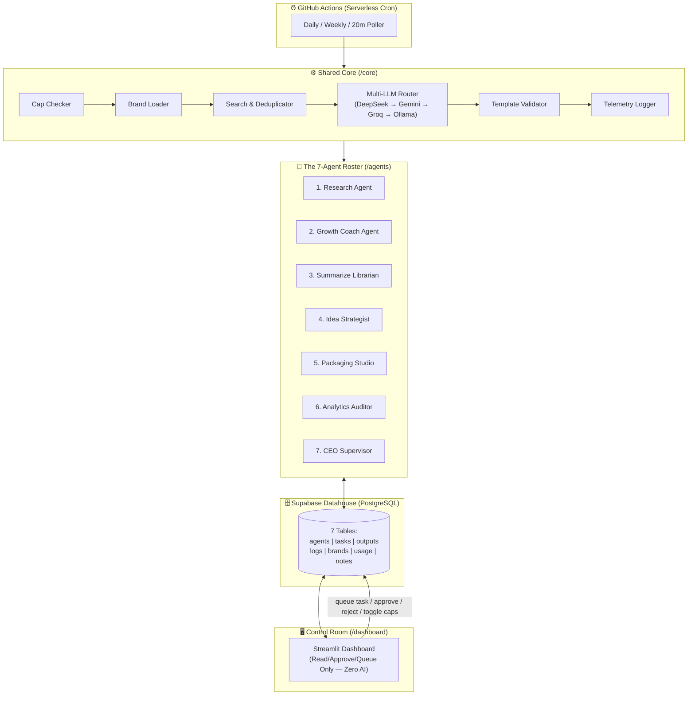
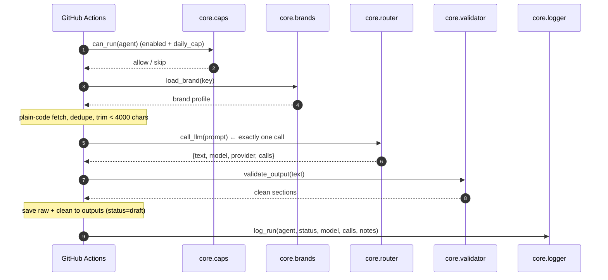
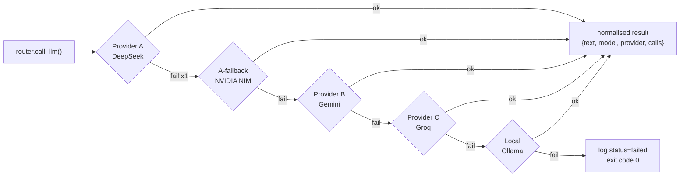

<div align="center">

# Rishi-OS

### *Autonomous Multi-Agent Operating System for Startups & Personal Growth (Zero-Budget Edition)*

**Seven scheduled agents. One model call each. Postgres as the brain. A dashboard that thinks about nothing.**

[](https://www.python.org/)
[](https://supabase.com/)
[](https://github.com/features/actions)
[](https://streamlit.io/)
[](#-the-zero-budget-ledger)
[](LICENSE)

</div>

---

## 🧭 What This Is

Rishi-OS runs a **seven-agent marketing, research, and personal-growth system** for two startups and a
personal brand — from a single dashboard, on a **zero-dollar budget**, using only free tiers and
serverless cron.

Three design convictions drive the whole repository:

1. **Determinism is cheaper than intelligence.** Scheduling, deduping, counting, hashing, and
   formatting are plain Python. The LLM never does a job a `for` loop can do.
2. **Loops are expensive.** No agent frameworks, no planning rounds, no reflection passes.
   One fixed workflow, **one model call per run**, then exit.
3. **A human is always the last step.** Agents produce `draft`s. Nothing publishes itself.

---

## 🗺️ System Architecture

<div align="center">



</div>

### Reading the diagram

| Layer | Role | Contains AI? |
|---|---|---|
| **⏰ Scheduler** | Serverless cron triggers jobs. No always-on server. | ❌ |
| **⚙️ Shared Core** | The only place models, caps, and telemetry are touched. | ✅ (router only) |
| **🤖 7-Agent Roster** | Thin, linear scripts. Each is one 5-step run. | ✅ (1 call each) |
| **🗄️ Supabase Datahouse** | The single source of truth — 7 tables, no local state. | ❌ |
| **🖥️ Control Room** | Human review, approvals, cap toggles. | ❌ **Zero AI** |

---

## 🤖 The 7-Agent Roster

| # | Agent | Job | Output status |
|:-:|---|---|---|
| 1 | **Research Agent** | Find fresh, deduped signal on a topic | `draft` |
| 2 | **Growth Coach Agent** | Personal progress & habit coaching | `needs_review` |
| 3 | **Summarize Librarian** | Compress long-form input into a library entry | `draft` |
| 4 | **Idea Strategist** | Turn signal into ranked content angles | `needs_review` |
| 5 | **Packaging Studio** | Draft platform-ready posts from one angle | `needs_review` |
| 6 | **Analytics Auditor** | Read metrics, report what actually worked | `draft` |
| 7 | **CEO Supervisor** | Weekly cross-agent review & prioritisation | `needs_review` |

Every one of them is **`status="draft"` or `"needs_review"` on write.** There is no publish path in this repo.

---

## 🔁 The Standard 5-Step Agent Pattern

Uniformity is the whole trick: one shape, learned once, applied seven times.



| # | Step | Call | Rule |
|:-:|---|---|---|
| 1 | Cap check | `core.caps.check_can_run(agent)` | `enabled` **and** under `daily_cap` |
| 2 | Brand + fetch | `core.brands.load_brand(key)`, then plain Python | trim to **< 4,000 chars** |
| 3 | **One** model call | `core.router.call_llm(prompt)` | never call a provider directly |
| 4 | Validate + persist | `core.validator.validate_output()`, save `raw` + `clean` | `status="draft"` |
| 5 | Telemetry | `core.logger.log_run(...)` | append-only to `logs` |

---

## 🔌 Model Router with Automatic Fallback

One router. Four providers. No agent is ever tied to a single key.



**Retry once, then fall through. Never loop.** Adding a provider means editing `core/router.py` only.

---

## 📁 Repository Layout

```
Rishi-OS/
├── .github/
│   └── workflows/          # serverless cron — daily / weekly / 20m poller
├── agents/                 # the 7 agents — thin, linear, 5-step
├── core/                   # shared plumbing (the only place with model access)
│   ├── router.py           #   multi-LLM fallback chain
│   ├── search.py           #   web search: Tavily, else keyless HN/Reddit/News
│   ├── caps.py             #   enabled + daily_cap enforcement
│   ├── brands.py           #   brand profile loader
│   ├── validator.py        #   section/template validation
│   ├── logger.py           #   append-only telemetry
│   └── db.py               #   Supabase read/write, dedupe by SHA-256 + URL
├── prompts/                # one .md template per agent, loaded by config.load_prompt
├── dashboard/              # Streamlit control room — ZERO AI
├── schema.sql              # the 7 tables
├── .env.example            # every key the system needs, no real values
├── AGENTS.md               # the binding rulebook for all sessions
└── requirements.txt
```

---

## 🚀 Quickstart

```bash
git clone https://github.com/RishiSakhija/Rishi-OS.git
cd Rishi-OS

python -m venv .venv
# Windows
.venv\Scripts\activate
# macOS / Linux
source .venv/bin/activate

pip install -r requirements.txt
```

Configure secrets:

```bash
cp .env.example .env      # Windows: Copy-Item .env.example .env
```

Then paste your keys into `.env`. **`.env` is gitignored — never commit it.**

Create the schema in your Supabase project by running `schema.sql` in the SQL editor.

Run an agent locally:

```bash
python -m agents.research_agent
```

Launch the Control Room:

```bash
streamlit run dashboard/app.py
```

---

## 🔑 Environment Variables

| Variable | Purpose | Required |
|---|---|---|
| `SUPABASE_URL` | Postgres project URL | ✅ |
| `SUPABASE_KEY` | Supabase anon / service-role key | ✅ |
| `DEEPSEEK_API_KEY` | Provider A (primary) | ✅ |
| `NVIDIA_API_KEY` | Provider A-fallback | ➖ |
| `GEMINI_API_KEY` | Provider B | ➖ |
| `GROQ_API_KEY` | Provider C | ➖ |
| `OLLAMA_BASE_URL` | Local last resort (default `http://localhost:11434`) | ➖ |
| `TAVILY_API_KEY` | Research / search ingestion | ➖ |
| `DASHBOARD_PASSWORD` | Control Room gate | ✅ |

The system degrades gracefully: **any one reachable provider is enough.**

---

## 🗄️ The Datahouse — 7 Tables

| Table | Holds |
|---|---|
| `agents` | Roster registry: `enabled`, `daily_cap`, `schedule`, config |
| `tasks` | Queued / claimed units of work |
| `outputs` | Generated content: `raw`, `clean`, `hash`, `status` |
| `logs` | Append-only telemetry: `agent`, `time`, `status`, `model`, `calls`, `notes` |
| `brands` | Brand profiles: voice, audience, platforms |
| `usage` | Per-run provider/call accounting for the zero-budget ledger |
| `notes` | Human notes, growth journal, ideas backlog |

**Status vocabulary:** `draft` · `needs_review` · `approved` · `rejected` · `failed` · `skipped`

**Dedup keys:** SHA-256 of normalised content **and** source URL. Both, not either.

---

## 🖥️ The Control Room

The Streamlit dashboard is a **control surface, not a runtime.**

| ✅ It does | ❌ It never does |
|---|---|
| Read every table | Import a model or the router |
| Approve / reject / edit drafts | Execute an agent directly |
| Toggle `enabled` and edit `daily_cap` | Contain a single line of AI |
| Queue work for the next cron tick | Hold business logic |
| Show the usage/cost ledger | Publish anything, anywhere |

To trigger work, the dashboard **writes a row or flips a flag**. GitHub Actions does the rest.

---

## 💸 The Zero-Budget Ledger

| Component | Cost | How |
|---|---|---|
| Compute | **$0** | GitHub Actions free minutes — no servers, no uptime bill |
| Database | **$0** | Supabase free tier (Postgres + auth + row limits) |
| Inference | **$0** | Free tiers across DeepSeek / NVIDIA / Gemini / Groq, then local Ollama |
| Search | **$0** | Tavily free tier, RSS via `feedparser`, transcripts via `youtube-transcript-api` |
| Dashboard | **$0** | Streamlit, run locally |
| Orchestration | **$0** | No LangChain, no CrewAI, no paid agent platform |

**Budget guardrails are code, not discipline:** hard caps per agent, one call per run,
inputs under 4,000 characters, and low-frequency schedules (daily / weekly / 20-minute poll).

---

## ⚖️ The Non-Negotiables

- **One** model call per run.
- Inputs trimmed **below 4,000 characters**.
- `enabled` + `daily_cap` checked **before** any work.
- Model access goes through **`core/router.py` only**.
- Failures log `status="failed"` and **exit `0`** — cron never loops.
- Outputs are always **`draft` / `needs_review`** — never published.
- **No AI code anywhere under `/dashboard`.**
- **No LangChain / CrewAI / agent frameworks.**

Full detail: [`AGENTS.md`](AGENTS.md).

---

## 📄 License

MIT — see [LICENSE](LICENSE).

<div align="center">
<sub>Built to be boring on purpose. Boring is cheap, and cheap is reliable.</sub>
</div>
